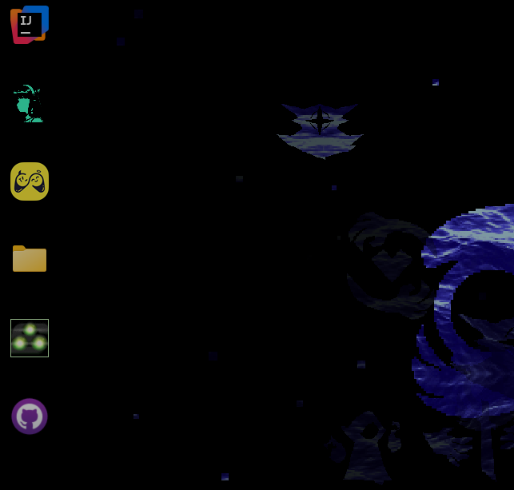

# Desktop Shortcut Cleaner for Windhawk

A Windows 11 Windhawk mod for cleaning up desktop shortcuts **without changing File Explorer**.

## Features

- Hide the text labels of **desktop shortcuts only**.
- Optionally hide the names of **all desktop icons**.
- Hide the standard shortcut arrow **on the desktop only**.
- Hide the blue/yellow **UAC (admin) shield** on desktop shortcuts whose target uses the *Run this program as an administrator* compatibility setting. It stays hidden after refreshing the desktop.
- Replace the white **hover/selection box** behind desktop icons with a **soft white glow that follows the icon's shape**. Hovered icons glow subtly; selected icons and drop targets glow brighter.
- In shortcut-only mode, **only shortcuts lose their labels**.
- File Explorer keeps its shortcut arrows, shields and normal highlight.

If **Hide all desktop icon text** is enabled, it overrides the shortcut-only text option.

A shortcut to a folder is still a shortcut, so its name is hidden when shortcut-only hiding is enabled.

### About the UAC shield

For shortcuts whose target has the *Run this program as an administrator* compatibility setting, Windows bakes the shield into the cached icon image. The mod extracts the shortcut's raw icon and draws it **only on the desktop** instead of the shielded one, so File Explorer is unchanged. The shortcut still runs as administrator. Only the icon changes.

### About the icon glow

The glow is generated from each icon's own transparency: its outline is slightly widened, blurred and filled with white, then drawn underneath the icon, so only the halo outside the icon's shape is visible. The hover strength can be tuned with `kGlowHoverAlpha` in the source (0 = none, 255 = full).

## Known limitations

- Labels are matched by their displayed text, so a non-shortcut item showing the same name as a shortcut (for example `Notes.lnk` and `Notes.txt` with extensions hidden) loses its label too.
- Shield hiding covers the *Run this program as an administrator* compatibility setting only. Shortcuts to programs whose manifest requests elevation (many installers) keep their shield, as do shortcuts whose target is on a network path.

## Screenshots

### Before

### Shortcut names and arrows hidden

### All desktop icon names hidden

### File Explorer remains unchanged

## Installation

Until the mod is available in the Windhawk catalog:

1. Install [Windhawk](https://windhawk.net/).
2. Enable **Developer mode** in Windhawk.
3. Create a new mod.
4. Replace the generated code with the contents of `desktop-shortcut-cleaner.wh.cpp`.
5. Compile the mod.
6. Enable it and configure the toggles in **Settings**.

## Compatibility

- Windows 11
- x86-64
- Windhawk

Windows updates can change Explorer internals, so future Windows builds may require adjustments.

## Credits

Based in part on **desktop icon text-hiding code by [kivsak](https://github.com/kivsak)**.

The desktop detection and icon-label hiding approach were adapted from their script, which hides the names of all desktop icons.

This project extends that approach with its own logic to hide labels **only for shortcuts**, while keeping labels visible for folders and other desktop items.

The desktop-only shortcut-arrow, administrator-shield and icon-glow handling are implemented separately by this project.

## License

MIT. See [LICENSE](LICENSE).
