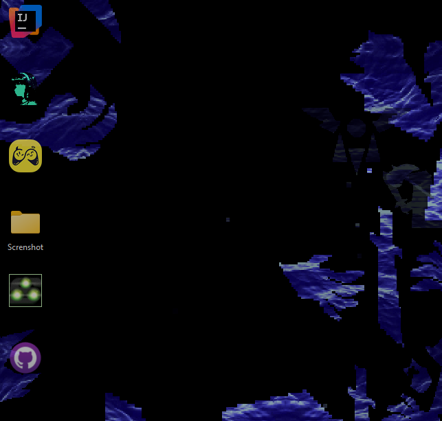
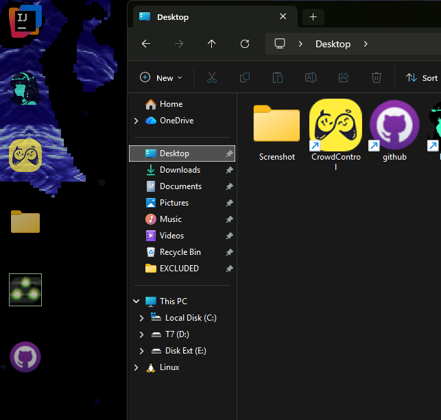

# Desktop Shortcut Cleaner for Windhawk

A Windows 11 Windhawk mod for cleaning up desktop shortcuts **without changing File Explorer**.

## Features

- Hide the text labels of **desktop shortcuts only**.
- Optionally hide the names of **all desktop icons**.
- Hide the standard shortcut arrow **on the desktop only**.
- In shortcut-only mode, **only shortcuts lose their labels**.
- Shortcut arrows remain visible in File Explorer.

### Default settings

| Setting | Default |
| --- | --- |
| Hide desktop shortcut text | On |
| Hide all desktop icon text | Off |
| Hide desktop shortcut arrows | On |

If **Hide all desktop icon text** is enabled, it overrides the shortcut-only text option.

A shortcut to a folder is still a shortcut, so its name is hidden when shortcut-only hiding is enabled.

## Screenshots

### Before

### Shortcut names and arrows hidden

### All desktop icon names hidden

### File Explorer remains unchanged

## Installation

Until the mod is available in the Windhawk catalog:

1. Install [Windhawk](https://windhawk.net/).
2. Enable **Developer mode** in Windhawk.
3. Create a new mod.
4. Replace the generated code with the contents of `desktop-shortcut-cleaner.wh.cpp`.
5. Compile the mod.
6. Enable it and configure the three toggles in **Settings**.

## Compatibility

- Windows 11
- x86-64
- Windhawk

Windows updates can change Explorer internals, so future Windows builds may require adjustments.

## Credits

Based in part on **desktop icon text-hiding code by [kivsak](https://github.com/kivsak)**.

The desktop detection and icon-label hiding approach were adapted from their script, which hides the names of all desktop icons.

This project extends that approach with its own logic to hide labels **only for shortcuts**, while keeping labels visible for folders and other desktop items.

The desktop-only shortcut-arrow handling is implemented separately by this project.

## License

MIT. See [LICENSE](LICENSE).
